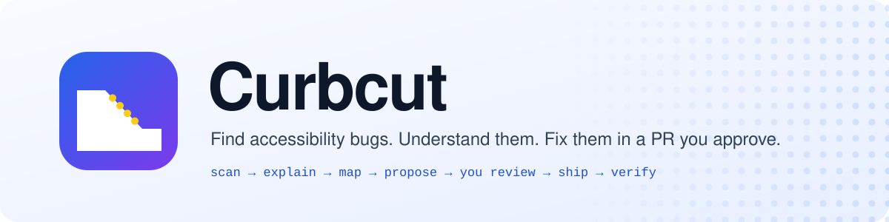
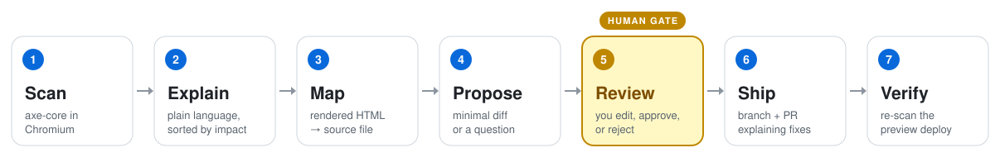

<div align="center">

<picture>
  <source media="(prefers-color-scheme: dark)" srcset="docs/assets/banner-dark.svg">
  
</picture>

<br>

[](https://github.com/CaseyKelly/Curbcut/actions/workflows/ci.yml)


[How it works](#how-it-works) · [Guardrails](#guardrails) · [Evals](#evals) · [Getting started](#getting-started) · [Status](#status)

</div>

> **Why "Curbcut"?** Curb cuts were made for wheelchair users, and then everyone with a stroller, a suitcase, or a bike started using them too. That's the _curb-cut effect_: accessibility work makes things better for everybody. This tool aims to make that work quicker to do.

Point Curbcut at a URL. An AI agent scans the page against WCAG 2.1 AA, tells you in plain language what's wrong and who it affects, finds the component in your repo that causes it, and drafts a minimal fix. **Nothing changes until a human approves the diff.** Then it opens a pull request and re-scans the preview deploy to check the fix worked.

<p align="center">
  
</p>

<details>
<summary>Text version of the mockup</summary>

```text
$ curbcut scan https://shop.example.com

  ✓ Loaded page in Chromium                 1.8s
  ✓ axe-core · WCAG 2.1 AA                  23 issues · 5 rules

  ● critical  image-alt        9  Images have no text alternative
  ● serious   color-contrast   8  Text is hard to read (3.1:1)
  ● serious   label            3  Form fields have no label
  ● moderate  heading-order    2  Headings skip a level
  ● minor     region           1  Content sits outside landmarks

  → Mapped 23 issues to 6 React components
  → Drafted 5 fixes and 1 question for you

  Review at localhost:3000/scans/42   nothing changes until you approve
```

</details>

> [!NOTE]
> This README describes the design we're building toward. Most of it isn't implemented yet. See [Status](#status) for what works today.

## How it works

<picture>
  <source media="(prefers-color-scheme: dark)" srcset="docs/assets/pipeline-dark.svg">
  
</picture>

| Step        | What happens                                                                                                                                                                |
| ----------- | --------------------------------------------------------------------------------------------------------------------------------------------------------------------------- |
| **Scan**    | A worker loads the page in Chromium and runs axe-core with the WCAG 2.1 AA rules. Every issue gets a stable fingerprint so we can tell later whether a fix landed.          |
| **Explain** | Issues are grouped by rule and sorted by impact. Each group gets one plain-language explanation: what's wrong, who it affects, and why it matters. Explanations are cached. |
| **Map**     | The agent pulls search terms out of the offending HTML (text, classes, ids, ARIA) and searches your repo to find the source file behind it.                                 |
| **Propose** | For each issue, the agent returns a small diff, says no change is needed, or says it's unsure and asks a question. It shouldn't guess.                                      |
| **Review**  | You see each diff next to its explanation and confidence score. Edit it inline, approve it, or reject it, one at a time or in bulk.                                         |
| **Ship**    | Approved patches go to a `curbcut/<scan-id>` branch and a PR that explains every fix. Once the preview deploys, Curbcut scans it again and comments with the results.       |

## Guardrails

An agent that writes to your repo needs limits. The most important one: the agent can propose changes, but only you can approve them.

```text
     AGENT                      YOU                          YOUR REPO
  ───────────              ─────────────                  ───────────────

  propose_patch ──diff──▶ ┌─────────────┐
                          │   review    │
                          │   edit      │ ──approve──▶ apply_patch ──▶ open_pr
                          │   decide    │
                          └──────┬──────┘
                                 │ reject
                                 ▼
                             discarded
```

The rest of the guardrails in the design:

- 🙋 **Human approval required.** `apply_patch` and `open_pr` refuse to run unless the specific patches have an approval record.
- 🔐 **Secrets stay out of prompts.** Repos are shallow-cloned into a temp directory that's deleted after the run. `.env*` files, keys, and certs are on a denylist, and a secret scanner redacts anything else before it reaches the model. A test plants a fake secret and fails if it ever shows up in an LLM request.
- 🧱 **Sandboxed tools.** `read_file` rejects path traversal, absolute paths, and symlinks that leave the repo. Search results have count and size caps.
- 💸 **Budgets.** Each run is limited to 25 steps, a cost cap, and 5 minutes. A monthly spend guard blocks LLM calls once the budget is reached.
- 🌐 **No SSRF.** Only http/https URLs are scanned, and private network addresses are rejected.
- 🔑 **Least-privilege GitHub App.** It can read and write contents and pull requests, and nothing else. Tokens are minted only in the worker and are never logged.

## Evals

Prompt changes have to beat the eval suite, not just look good in a demo. Every proposed fix is scored on whether it:

| Scorer             | Question                                                                                                                    |
| ------------------ | --------------------------------------------------------------------------------------------------------------------------- |
| **Resolved**       | Does axe still flag the patched component, and did the patch add any new violations?                                        |
| **Build safe**     | Does it pass `tsc`, ESLint, and the case's own tests?                                                                       |
| **Scoped**         | Does the diff only touch the lines it needs to? (Any diff on a no-change case fails.)                                       |
| **Quality**        | Is it correct, minimal, and idiomatic React, using native elements before ARIA? (LLM judge, calibrated against hand labels) |
| **Cost & latency** | What did it cost, and how long did it take?                                                                                 |

**Planned CI tiers ([#17](https://github.com/CaseyKelly/Curbcut/issues/17), not running yet):** a free **replay** tier on every PR, a **smoke** tier when the agent or prompts change, and the **full** suite weekly. Every PR will get a comment with its score diff against `main`. Today, CI runs `npm run check` (format, lint, typecheck, and unit tests) and an axe scan of the sample site against its seeded-issue manifest on every push and PR.

## Getting started

Requires Node 22 (`nvm use` reads `.nvmrc`).

```bash
npm install
npm run dev     # web app at http://localhost:3000
npm run check   # format, lint, typecheck, tests (what CI runs)
npm run sample-site   # the deliberately broken demo site at http://localhost:5173
```

## Project layout

| Path                   | What                                         | Owner   |
| ---------------------- | -------------------------------------------- | ------- |
| `apps/web`             | Next.js app: UI, route handlers, auth        | Casey   |
| `apps/worker`          | Job runner: scans and agent runs             | Casey   |
| `packages/core`        | Zod schemas shared by the app and the evals  | Both    |
| `packages/agent`       | LLM provider, prompts, agent loop, tools     | Casey   |
| `packages/db`          | Drizzle schema and migrations                | Casey   |
| `packages/evals`       | Eval dataset, runner, scorers                | Upasana |
| `fixtures/sample-site` | React app with deliberate a11y bugs          | Upasana |
| `e2e`                  | Playwright end-to-end tests                  | Upasana |
| `docs`                 | Test strategy, release checklist, prompt log | Both    |

Workspace packages export TypeScript source directly, with no build step. Next.js compiles them through `transpilePackages`, and the worker runs with `tsx`.

## Status

The repo scaffold is done. Most of the features above are still being built and are tracked in [Issues](https://github.com/CaseyKelly/Curbcut/issues). Architecture details, current eval scores, and known limitations will be added here as they land (see [#35](https://github.com/CaseyKelly/Curbcut/issues/35)).

We hold our own UI to the same standard: every page has to pass an axe scan with zero violations and work with only a keyboard.

## Team

Built by **Casey Kelly** and **Upasana Kelly-Ajbani**.

<div align="center">
<br>
<sub>Curb cuts were built for some people and turned out to help everyone. Accessible software works the same way.</sub>
</div>
